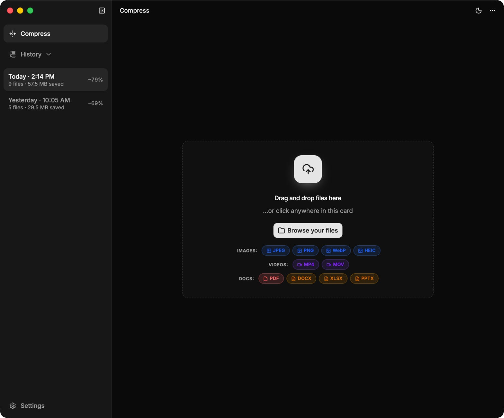
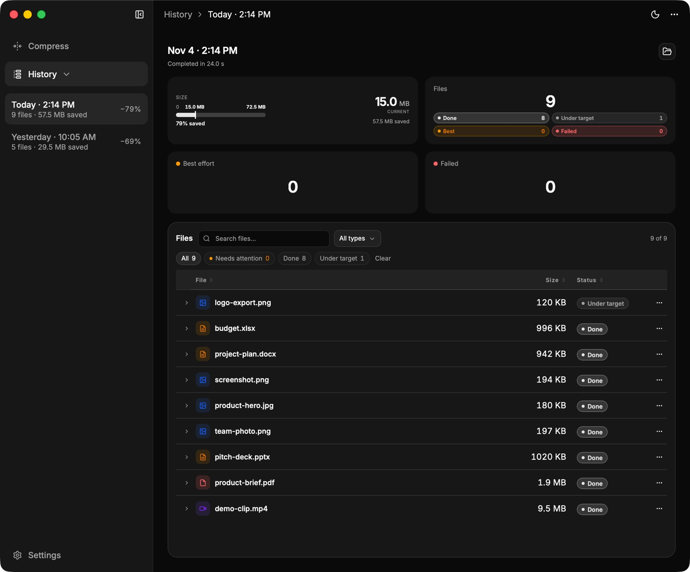
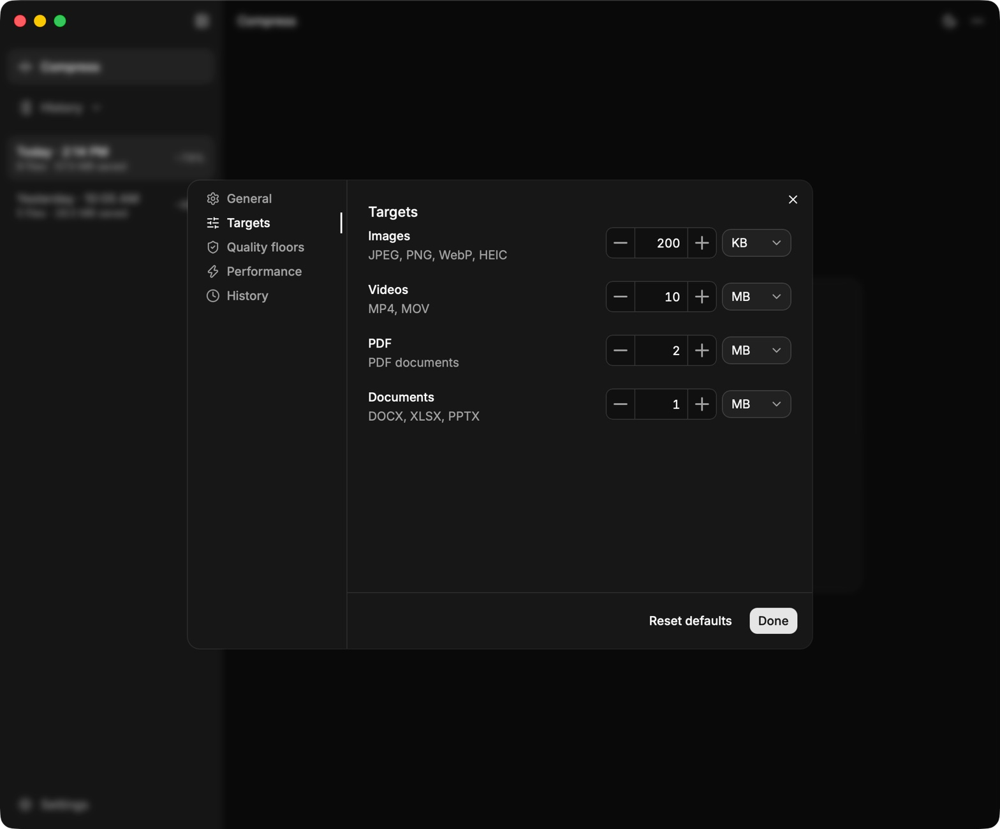

<p align="center">
  
</p>

<h1 align="center">Yard</h1>

<p align="center">
  Offline batch file compression for macOS and Windows.
  <br>
  Images, video, PDF, and Office documents — compressed to target sizes, never uploaded.
</p>

<p align="center">
  <a href="https://github.com/initgrep-apps/yard/actions/workflows/ci.yml"></a>
  <a href="https://github.com/initgrep-apps/yard/releases/latest"></a>
  <a href="LICENSE"></a>
  <a href="#download"></a>
</p>



Yard takes a batch of files, gives each one a size limit based on its type, and
compresses it as close to that limit as quality allows. Everything runs on your
machine: the compression engines are bundled, and there is no telemetry, account,
or network access.

## Features

| | |
|---|---|
| **Category targets** | Images, video, PDF, and documents each get a target size. Defaults are editable in Settings. |
| **Bundled engines** | libvips, FFmpeg, qpdf, and Ghostscript ship with the app. No runtime downloads. |
| **Originals stay untouched** | Results go to a separate output folder. Destructive changes — downscaling, dropping a stream, changing format, rasterising — need your permission; a few, such as dropping a PDF page, are refused outright. HEIC/HEIF becomes JPEG by default and MOV becomes MP4. |
| **Batch workflow** | Parallel compression, per-file progress, per-file cancel, and cancel-all. |
| **History** | A local audit trail with per-file sizes, methods, timings, the changes each file needed, any consent grant, and a 90-day retention default. |
| **Offline by design** | No telemetry, no cloud processing, no auto-update. Your files never leave the machine. |

## Download

| Platform | Installer |
|---|---|
| macOS 11+ · Apple Silicon | [](https://github.com/initgrep-apps/yard/releases/latest/download/Yard-macOS-arm64.dmg) |
| macOS 11+ · Intel | [](https://github.com/initgrep-apps/yard/releases/latest/download/Yard-macOS-x64.dmg) |
| Windows 10+ · x64 | [](https://github.com/initgrep-apps/yard/releases/latest/download/Yard-Windows-x64-setup.exe) |
| Windows 10+ · arm64 | [](https://github.com/initgrep-apps/yard/releases/latest/download/Yard-Windows-arm64-setup.exe) |

All installers, checksums, SBOM, and third-party notices are on the
[Releases page](https://github.com/initgrep-apps/yard/releases/latest). Each
installer has a matching `.sha256` file.

### Installing on macOS

The macOS builds are ad-hoc signed and not notarized, so Gatekeeper quarantines
the download. Copy the app first, then remove the quarantine mark:

```bash
hdiutil attach ~/Downloads/Yard-macOS-arm64.dmg
cp -R /Volumes/yard/yard.app /Applications/
hdiutil detach /Volumes/yard
xattr -dr com.apple.quarantine /Applications/yard.app
```

**System Settings → Privacy & Security → Open Anyway** is the alternative after
the first launch attempt. On macOS 15+ it is the only route when the command is
not used.

### Installing on Windows

Run the installer. When SmartScreen warns, choose **More info** → **Run anyway**.
The Windows builds are unsigned.

## Usage

1. Drop files onto the window, or click **Browse your files**.
2. Press **Compress**. Progress is shown per file; cancel any file or the batch.
3. Open the output folder from the result row, or browse the batch in **History**.

Targets, quality floors, memory ceiling, output folder, and history live in **Settings**. Destructive changes prompt before delivery; denying one leaves no output for that file.

## Supported formats

| Type | Input | Output |
|---|---|---|
| Images | JPEG, PNG, WebP, HEIC/HEIF | JPEG, PNG, WebP; HEIC/HEIF becomes JPEG |
| Video | MP4, MOV | MP4 |
| PDF | PDF | PDF |
| Documents | DOCX, XLSX, PPTX | Same format, embedded media recompressed |

## Screenshots

### History



### Targets



## System requirements

| | Minimum | Recommended |
|---|---|---|
| CPU | 2 cores | 6–8 logical cores |
| RAM | 4 GB | 16 GB |
| Disk | SSD, room for the largest file plus its attempts | SSD, 30 GB free |
| OS | macOS 11+ / Windows 10+ | Same |

Per-file RAM is bounded: Office documents stream archive entries instead of loading the
whole archive, and images hold one image at a time. Parallel jobs are admitted against a
batch memory budget of `clamp(total RAM / 8, 300 MiB, 2 GiB)` — about 512 MiB on a 4 GB
machine and 2 GiB on 16 GB or more. The budget is overridable in **Settings → Performance**.

A large document no longer needs RAM proportional to its archive size, but it still needs
temporary disk space: extracted media and every attempt stay on disk until its job ends. A
batch of large files can therefore use several times the input size in temp space.

## Security

Yard processes files locally and sends nothing over the network. To report a
vulnerability, use [GitHub private vulnerability reporting](https://github.com/initgrep-apps/yard/security/advisories/new)
as described in [`SECURITY.md`](SECURITY.md). Do not open a public issue for a
security report.

Release assets are built on native GitHub-hosted runners, gated by the full test
suite and a package-content check, and published with SHA-256 checksums. The
builds are not code-signed or notarized yet.

## Development

Requirements: Node.js 22, [yarn](https://yarnpkg.com/), Rust stable, and the
[Tauri 2 prerequisites](https://v2.tauri.app/start/prerequisites/) for your
platform.

```bash
yarn install
yarn binaries:all     # one-time: download, verify, and stage the engines (~150 MB)
yarn tauri dev
```

Run the gate before pushing:

```bash
yarn build && yarn test && (cd src-tauri && cargo test)
```

See [`CONTRIBUTING.md`](CONTRIBUTING.md) for the PR process, commit conventions,
and release rules.

### Project layout

```
src/                  Frontend — UI only, no compression logic
src-tauri/src/        Rust core — commands, queue, scheduler, processors, history
scripts/binaries/     Sidecar supply chain (manifest → lock → fetch → prep → audit)
scripts/ci/           Freeze/unfreeze, package gate, workflow tests
docs/                 Architecture, features, ADRs, CI runbook, known gaps
```

### Documentation

- [`docs/ARCHITECTURE.md`](docs/ARCHITECTURE.md) — components, IPC, algorithms, limits
- [`docs/FEATURES.md`](docs/FEATURES.md) — shipped slices and research backlog
- [`docs/adr/`](docs/adr/) — decisions and rejected alternatives
- [`docs/ci-process.md`](docs/ci-process.md) — CI model, release runbook, failure table
- [`docs/bugs.md`](docs/bugs.md) — open bugs and known gaps
- [`GLOSSARY.md`](GLOSSARY.md) — project vocabulary

## License

GPL-3.0 — see [`LICENSE`](LICENSE). Bundled engines keep their own licenses:
FFmpeg GPL-2.0-or-later, Ghostscript AGPL-3.0, libvips LGPL-3.0, qpdf
Apache-2.0. See [`THIRD_PARTY_LICENSES.md`](THIRD_PARTY_LICENSES.md).
