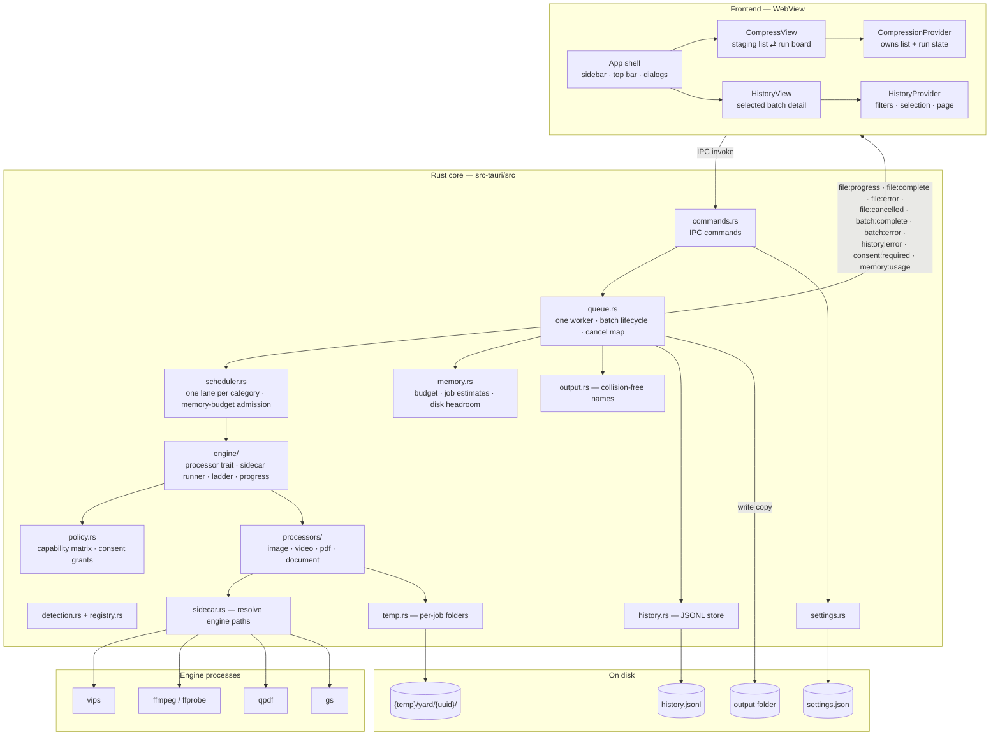
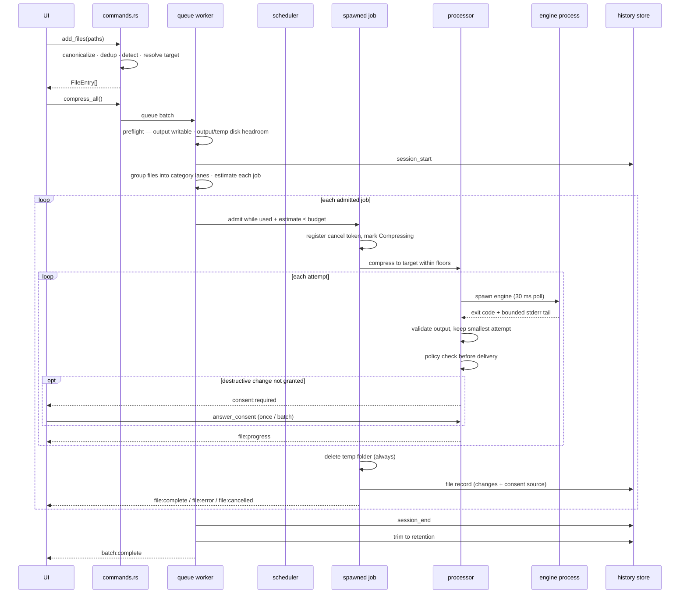

# Yard — Architecture

**Scope:** the code as it exists today. Design intent and rejected alternatives live in `docs/adr/`. What shipped lives in `docs/FEATURES.md`. Known gaps live in `docs/bugs.md`.

## 1. What it is

An offline desktop app that compresses batches of files toward a per-category size target. The user stages files, presses Compress, and the app runs bundled command-line engines over them. Originals are never modified; results are written as copies to a separate output folder. No network, no accounts, no telemetry.

- Platforms: macOS (arm64, Intel) and Windows (x64, arm64). Linux builds from source but is not packaged.
- License: GPLv3. Engines keep their own licenses — FFmpeg GPLv2+, Ghostscript AGPLv3, libvips LGPLv3, qpdf Apache-2.0.

## 2. Stack

| Layer | Technology |
|---|---|
| Desktop shell | Tauri 2.12 (Rust) |
| Frontend | React 19.3 + TypeScript 7.0 + Vite 8.3 (Rolldown) |
| UI | shadcn/ui 4.23 on Base UI (`@base-ui/react` 1.9), Tailwind CSS 4.3, motion 14, sonner |
| Rust | Tokio, tokio-util, serde, uuid, dirs, sysinfo, `zip` 9 (deflate only) |
| Tauri plugins | opener, dialog, store, os, window-state, single-instance |
| Engines | vips 8.18.7, ffmpeg/ffprobe 9.0.2, qpdf 12.4.2, gs 10.08.0. Intel macOS is pinned one release behind: vips 8.18.6 / gs 10.07.1 (ADR 0001) |

Release profile: `lto`, `codegen-units=1`, `opt-level=3`, `panic=unwind`, `strip`.

## 3. Components



**Boundary rule:** `src/` renders and calls IPC; every compression decision lives in `src-tauri/src/`.

## 4. Frontend

### Shell

`main.tsx` applies the stored or OS theme before the first render, detects the platform synchronously through `plugin-os`, then mounts `ErrorBoundary → PlatformProvider → App`.

```
PlatformProvider
└── CompressionProvider
    ├── QuitGuard
    └── HistoryProvider
        └── SidebarProvider
            ├── Sidebar (stock shadcn, offcanvas)
            ├── SidebarInset: TopBar + active view
            └── SettingsDialog · AboutDialog · HistoryFilterDialog · Toaster
```

- `Shell` (inside `App.tsx`; `App` itself only mounts the providers) owns `activeView` (`compress` | `history`) plus the settings, About and filter dialog state. One view is mounted at a time; there is no router.
- The top bar holds the breadcrumb, theme toggle and ⋯ app menu; on non-macOS platforms it adds minimize/maximize/close. The sidebar header owns the collapse trigger on every platform while the sidebar is open; the top bar renders `SidebarActions` only while the sidebar is hidden (on macOS it keeps the `pl-22` traffic-light clearance). ☰ appears only while the sidebar is hidden. The whole bar is a drag surface and interactive children stop propagation. See ADR 0007.
- The sidebar is the stock shadcn `Sidebar`: `offcanvas` on desktop, the vendored Sheet below 768px, stock widths (16rem / 18rem). `src/components/ui/sidebar.tsx` keeps two local tweaks: `min-w-0` on `SidebarInset`, and `SidebarTrigger` carries the collapse/expand label with fold/unfold icons. Open state is session-only.
- `HistoryList` lives inside the sidebar — batch rows and pagination, the only scroller in the sidebar. The History nav row is a disclosure that shows or hides that list and never changes the active view; only a batch row navigates. Selecting a batch focuses its detail in `HistoryView` and adds its label to the breadcrumb; the detail card scrolls its own content. There is no sidebar search field; `HistoryFilters.search` stays available below the UI.
- Settings and About are dialogs; there is no settings view. Settings auto-save after a 400 ms debounce and flush on close.

### Views

- `CompressionProvider` and `HistoryProvider` sit above the view switch, so the staged list, an in-flight run, history filters and the selected batch survive navigation.
- Compress has two screens: **staging** (drop zone + file list + summary footer) and **run** (header + kanban board, one lane per category). "New batch" clears the list and returns to an empty staging screen.
- History is a detail pane for the batch selected in the sidebar; there is no third column.
- Dark mode: `useTheme` reads `localStorage["yard-theme"]`, follows `prefers-color-scheme` when unset, toggles `.dark`, and syncs the native window theme. `main.tsx` applies the first value before `createRoot`.

### State ownership

| State | Owner |
|---|---|
| `activeView`, settings/About/filter dialog open | `Shell` inside `App.tsx` |
| sidebar open (desktop `open`, mobile Sheet `openMobile`) | `SidebarProvider` — session-only |
| history expanded, selected batch, filters/sort/page/search/data | `HistoryProvider` over `useHistory` |
| `files`, list error | `useFileList` — every mutation calls Rust first, then stores the returned list |
| run screen, batch number, roster, batch outcome | `CompressionProvider` |
| `isCompressing`, `progressByFile` | `useCompression` — driven by events |
| window-close interception | `QuitGuard` under `CompressionProvider` — reads `isCompressing` |
| platform | `PlatformProvider` over `plugin-os` |
| theme | `useTheme` — localStorage, OS fallback |
| settings draft | `SettingsDialog` — boolean dirty ref, 400 ms debounce and flush on close; `useSettings` owns the loaded settings and the load/save race guard |

During a batch Rust is authoritative: the frontend applies events and ignores events for files that left the list. See ADR 0004.

### IPC surface

Commands (frontend → Rust): `add_files`, `remove_file`, `clear_list`, `get_settings`, `save_settings`, `reset_settings`, `compress_all`, `answer_consent`, `cancel_file`, `cancel_all`, `reveal_in_folder`, `get_history`, `clear_history`, `open_folder`, `memory_stats`, `quit`.

Events (Rust → frontend): `file:progress`, `file:complete`, `file:error`, `file:cancelled`, `batch:complete`, `batch:error`, `history:error`, `consent:required`, `memory:usage`. Payload fields are camelCase on the wire; `FileStatus` values are snake_case and categories are lowercase.

`FileStatus` is `pending`, `compressing`, `done`, `best_effort`, `failed`, `cancelled`, `unsupported`, `already_under_target`, `needs_permission`. The TypeScript union in `src/types.ts` is checked against the Rust enum by a file-reading test.

`HistoryFilters` carries `sort` (`newest` default, `oldest`). Sorting happens before pagination; an absent or unknown value falls back to `newest` (`sort: null` is valid).

Capabilities grant plugin defaults, `os:default`, `window-state:default`, and window start-dragging/minimize/toggle-maximize/close/set-theme to window `main`; custom commands need no entry. CSP is `script-src 'self'` with `style-src 'unsafe-inline'` for Tailwind.

Window chrome and plugin wiring: macOS uses an overlay title bar, Windows is frameless with the default shadow, Linux keeps native decorations and is not packaged. `window-state` restores size, position, maximized, visible and fullscreen, but never decorations; `single-instance` focuses the existing window on a second launch. See ADR 0007.

### Rendering cost

List rows and kanban cards are not memoized and lists are not virtualized. Every `file:progress` event re-renders the active run view, and video emits one event per ffmpeg output line. This is a known performance debt, not a correctness problem (`docs/bugs.md`).

## 5. Rust core

### Module map

```
lib.rs          plugin wiring, macOS menu, managed state, setup hook, command registry
commands.rs     IPC surface + settings load/save + file list state
queue.rs        single worker task, batch lifecycle, cancel maps, consent broker, events
scheduler.rs    budgeted lane scheduler (no Tauri dependency)
memory.rs       RAM budget, per-job estimates, process RSS, disk headroom
policy.rs       capability matrix + consent grants
engine/         CompressionProcessor trait, JobContext, Ladder, sidecar runner, progress
processors/     one module per category
sidecar.rs      engine path resolution + gs resource discovery
registry.rs     the single extension → category → output-extension table
detection.rs    category lookup through the registry
output.rs       collision-free output names + reservation registry
temp.rs         per-job temp folders + 24 h startup sweep
history.rs      JSONL records, folding, filtering, retention
settings.rs     schema, defaults, target resolution
```

`QueueState::new` starts exactly one worker task. Batches never overlap; parallelism happens inside a batch.

### Batch lifecycle



Details that change behavior:

1. **Preflight.** The app creates the output folder and writes/deletes a probe file, then requires `1.1 × largest original` free where outputs land and `largest job estimate / 2` free on the temp volume. Failure emits `batch:error` before any history record is written.
2. **Cancel tokens register before the status flips** from Pending to Compressing, so a cancel can never miss a job that just started.
3. **Panics are caught** by `catch_unwind` in release builds (`panic = "unwind"`) and reported as an unknown error; one file's panic does not kill the batch (ADR 0014). Each job body runs in `spawn_blocking`, so the async worker is never parked on a 30 ms engine poll.
4. **Output names** try `name.ext`, `stem-1.ext` … `stem-999.ext`, then `stem-overflow.ext`, then a uuid fallback. An in-memory reservation registry stops parallel jobs from claiming the same name. Extensions come from `registry.rs`: HEIC/HEIF → JPG, MOV → MP4. The mapping also applies to an `already_under_target` copy, which keeps its original bytes under the mapped extension.
5. **History is append-per-record.** A failed write emits one `history:error` per batch; compression results are unaffected.

### Concurrency and memory (ADR 0003, ADR 0010)

- One lane per category; at most one job per lane. Each lane keeps file-list order. The lane model is retained from ADR 0003; only the admission currency changed.
- A job is admitted only when `used + estimate ≤ budget`. Estimates come from `memory.rs`: image 4 × input, PDF 3 × input, document max(4 MiB, 4 × input), video input + 400 MiB × (width / 1920)² with an unknown width assumed to be 3840 px, other 0. They are conservative figures, never measurements.
- Budget: `adaptiveMemory` on → `clamp(total RAM / 8, 300 MiB, 2 GiB)`; off → `memoryCeilingMb` clamped to the same bounds.
- An estimate larger than the whole budget runs alone rather than deadlocking; that case is logged once per batch.
- A job that finishes frees its estimate immediately, so a queued job in another lane can start while a long video still runs.
- Cancel-all stops new admissions and skips queued jobs (`file:cancelled` plus a cancelled history record). In-flight jobs receive their file-token cancel and are allowed to finish their terminal history/event writes instead of being dropped with the scheduler.
- Each running job is a `spawn_blocking` task; the engine runner's 30 ms poll no longer parks a tokio runtime worker.
- `memory_stats` reports `totalRamBytes`, `budgetBytes` and `processRssBytes`; `memory:usage` reports budget, used and RSS every 2 s while a batch runs. RSS is display-only and never feeds admission.

### Cancellation

`cancel_file` cancels a live token or, if the job has not started, marks the entry cancelled directly. `cancel_all` cancels every batch token, then every file token. The runner calls `kill()` and re-checks cancellation after the process exits, so a cancel always wins over an exit code. SIGKILL reaches only the direct child; an engine's own children may outlive it. Stderr and stdout drain threads are joined after the child exits and retain only bounded tails. Per-processor cleanup: video deletes attempt outputs and passlogs, PDF deletes attempt files, image checks the token each iteration, document re-checks at every copy step and never deletes a pre-existing output. Temp cleanup always runs at job end.

### Engine processes

- **Resolution order.** Windows engines that need sibling DLLs live in `<install>/resources/engines/<name>/`; the resolver probes that first, then the dev-checkout layout. Flat candidates: `{name}-{triple}[.exe]`, `{name}`, `{name}.exe`. ffmpeg/ffprobe use flat candidates only. macOS ships all engines flat in `Contents/MacOS/`.
- **Environment.** Only `PATH` is touched, and only on Windows (the engine's DLL folder goes first). Windows child processes are spawned with `CREATE_NO_WINDOW` so no console flashes.
- **Runner.** stdout is discarded except for qpdf probes, which capture a 64 KiB maximum; stderr is drained on a thread into a 2 KiB tail that is rendered as the last 500 characters in a failure. Poll every 30 ms. Each engine may tolerate exit codes (qpdf 3 = warnings, output still used; qpdf 2 = errors, fails the pass).
- **Output commit.** Delivery copies to `<full file name>.yard-tmp` (for example `report.jpg.yard-tmp`), so same-stem outputs in different category lanes never share a temp path. It checks the cancel token between 64 KiB chunks, then commits with a hard link (or checked rename where links are unsupported). A cancel or copy error removes the temp; a final path is never partially written.
- **Video progress** parses `time=` and `out_time_ms=` (microseconds despite the name) from the ffmpeg stream, takes the larger value, and maps it into the current attempt's range.
- **gs resources.** The macOS package carries a `gs-resources` tree; its absence degrades to a hint in the error, not a hard failure. Windows uses Ghostscript's compiled-in tree (ADR 0001).

## 6. Processors

All processors share one contract: an input already under target becomes a plain byte copy (`already_under_target`); each attempt writes its own temp file; a `BestAttempt` tracker keeps the smallest strictly-smaller result; every output is checked — exit code 0 is not success. Because the under-target shortcut runs before any processor work, its output keeps the original bytes under the mapped extension: a HEIC stays HEIC inside a `.jpg`, a MOV stays MOV inside a `.mp4`, and image orientation/colour normalization does not run. Before delivery, the ladder checks that the rung declared every change it made and asks `policy.rs` for a verdict (ADR 0011, 0012).

| Category | Ladder | Validation |
|---|---|---|
| Image | Quality binary search (≤ 8 steps, floor → 95) at full size; then 0.9× dimension rungs down to `minLongEdge` (default 1280 px). PNG skips the quality search and uses palette compression: one full-size pass, then the same dimension rungs. Every attempt is `vips thumbnail` with autorotation, sRGB output profile and `keep=icc`. | Non-zero size; strict vips exit |
| Video | Probe duration and streams. One ABR two-pass at the highest allowed resolution (1080 cap 1920); then CRF 23 and the CRF floor (default 28) at the lower allowed resolutions (or at the top rung when only one is allowed). All audio and subtitle tracks are mapped, audio is AAC 128 kbps, pixels are `yuv420p`, and `+faststart` moves `moov` first; chapters and container metadata are copied. Attachments are not mapped, so any attached stream requires the `DropStream` grant. Clips < 0.5 s are rejected; a bitrate below 50 kbps skips ABR. | `ftyp` marker + size; duration within 1 %; exactly one video stream; audio/subtitle counts not below input |
| PDF | qpdf lossless (`--linearize --object-streams=generate --compression-level=9`) → qpdf `--optimize-images --jpeg-quality=75` (**lossy**) → gs grid dpi 100/72/50/36 × jpegq 60/40/25/15, filtered by floors (up to 16 gs cells; 8 at default floors). Every gs pass uses `-dPDFSETTINGS=/screen`; `-r<dpi>` only affects rasterised vector content, so each cell also passes `-dColorImageResolution`, `-dGrayImageResolution`, and `-dMonoImageResolution` to make the image downsampling rung effective. A failing pass never stops the ladder. | `%PDF-` header + non-zero size + qpdf `--show-npages` equality; a probe failure rejects the attempt |
| Document | The central directory is read up front; entries are streamed one at a time in each pass. Only exact `word/media/`, `ppt/media/`, `xl/media/` entries are recompressed via `vips thumbnail` (≤ 8 quality steps plus one adjacent-quality confirmation) with autorotation, sRGB output and `keep=icc`, then stored uncompressed; every other entry is streamed and deflated at level 9. A media entry that fails keeps its original bytes; a media fallback too large for a `Stored` write raw-copies the original compressed entry, and pass-through media (EMF/WMF) is raw-copied too. Rejects duplicate names, > 4 GiB declared uncompressed, and a > 200:1 compression ratio. | `ZipWriter` finishes; fixtures reopen the output and compare the entry set |

Never use ffmpeg `-fs`: it truncates the file. Size is controlled by bitrate, then resolution, then CRF.

### Consent

The capability matrix is seven change kinds × five categories (`policy.rs`): lossy encode, downscale, drop stream, format change, metadata strip, rasterise, page drop. Each rung declares the changes it can make; the ladder rejects an undeclared change and removes that attempt. A `NeedsConsent` verdict emits `consent:required`, and `answer_consent` grants once or for the rest of the batch. A denial streak of two silences repeat prompts for that change in that batch; the answer timeout is 30 minutes. A denied or unanswered rung is removed immediately. If an earlier authorised over-target attempt exists, it is still delivered as best effort, carrying only its own authorised changes; the image ladder records full-size over-target attempts before its consent-gated dimension rungs. `needs_permission` is returned only when no authorised attempt remains, and the settle guard removes any stale delivery. Best effort is delivered only when every change the delivered attempt made was authorised.

Grants come from `ConsentSource`: `default` (allowed with no grant, or the built-in HEIC → JPEG permission), `global` (`consent.allowDestructive`), `category` (policy-level, no shipped UI control), `batch`, and `once`. History stores only non-default sources; old JSONL lines default to an empty change list and no source.

## 7. Data on disk

| Data | Location | Notes |
|---|---|---|
| Settings | `settings.json` via plugin-store, key `settings` | camelCase; every field defaulted; unreadable file falls back to defaults |
| History | `{app_data_dir}/history.jsonl` | Append-only, three record kinds, camelCase. File records carry `changes` and `consentSource`; both default for old lines. Retention trim (default 90 days, 1…3650) runs at startup and after each batch via temp file + rename. Corrupt lines are skipped and counted. |
| Temp | `{OS temp}/yard/{uuid}/` | Attempt outputs, passlogs, extracted document media. Always deleted at job end; entries older than 24 h are removed at startup. |
| Outputs | Settings `outputFolder` (default `~/Documents/Compressed`) | Never deleted automatically; names avoid collisions |

Settings schema: `outputFolder`; `categoryTargets` (`image`, `video`, `pdf`, `document` → `{ size, unit: "KB" | "MB" }`); `qualityFloors` (`image.minQuality` 30 / `image.minLongEdge` 1280, `video.minCrf` 28 / `video.minResolution` 480p, `pdf.minDpi` 72 / `pdf.minJpegQuality` 15, `document.minMediaQuality` 40); `performance.adaptiveMemory` true / `performance.memoryCeilingMb` 2048; `history.retentionDays` 90; `consent.allowDestructive` false / `consent.heicToJpg` true. The legacy `performance.maxConcurrent` key is ignored with one warning.

History queries parse the whole retained file per call (ADR 0005). A session is never split across pages; the requested page is clamped to the last valid one; page size defaults to 50.

## 8. Failure behavior

`CompressionError` = `Cancelled`, `NeedsPermission`, `SidecarNotFound`, `SidecarFailed`, `InputFileError`, `OutputFileError`, `DiskFull`, `Unknown`. User-facing strings are pinned by tests; adding a variant breaks the build on purpose. Across IPC errors become strings inside events.

Poisoned mutexes are recovered with a warning, never a permanent stall. Missing history store disables history silently; unreadable settings use defaults; missing gs resources only annotate gs failures. Exit code 0 still gets its output checked.

## 9. Build and supply chain

- **Manifest = intention, lock = truth.** `scripts/binaries.manifest.json` (URL/brew source, sha256, expected version per triple) → `binaries:fetch` verifies and stages → `binaries:lock.json` records what landed. `prep` shapes the platform layouts; `verify` checks architecture and versions; `audit` runs a clean-room gs smoke test.
- **Freeze once, consume everywhere (ADR 0001).** `freeze.yml` stages all four triples and publishes `sidecars-<date>` (8 assets). Every CI consumer unfreezes its triple and verifies the bundle sha; nothing brews outside the freeze run.
- **Packages.** macOS: five `externalBin` engines flat in `Contents/MacOS/`, 71 framework dylibs, `gs-resources`, ad-hoc signed with one entitlement (ADR 0002). Windows: ffmpeg/ffprobe flat beside the exe, vips/gs/qpdf as `resources/engines/<name>/` with their DLLs.
- **Release guard.** Every release row runs `package-gate.mjs`, which opens the built package and runs each engine once. The gate exists because alpha.1 shipped engines that could not start.
- **Workflows.** `ci.yml` (2-row PR gate), `freeze.yml`, `release.yml` (4 native rows), `release-please.yml` (draft release PRs). Details and runbooks: `docs/ci-process.md`.
- Measured macOS arm64 package: ~214 MiB with engines and dylibs.

## 10. Resource limits

| Fact | Value |
|---|---|
| Batch budget | `adaptiveMemory` on: `clamp(total RAM / 8, 300 MiB, 2 GiB)` · off: `memoryCeilingMb` clamped the same way |
| Jobs at once | As many as fit the budget; one per category lane |
| Same-category jobs | 1 |
| Admission estimate | image 4 × input · PDF 3 × input · document max(4 MiB, 4 × input) · video input + 400 MiB × (width / 1920)², unknown width = 3840 · other 0 |
| Oversize job | An estimate above the whole budget runs alone |
| Engines per job | image: ≤ 8 quality probes plus one vips run per 0.9× dimension rung · video: ≤ 7 attempts (one two-pass + up to six CRF) = ≤ 8 ffmpeg runs and ≤ 8 ffprobe probes · PDF: ≤ 18 compression passes (2 qpdf + up to 16 gs) plus two qpdf page probes per validated pass · document: ≤ 9 vips passes per recompressible media entry (8 search + 1 confirmation) |
| Memory | bounded per file: documents stream one entry at a time; images hold one image; engine children get the admission estimate. RSS is displayed, never enforced. |
| Temp disk | every attempt is kept until the job ends; documents also extract each media entry. Preflight requires `largest job estimate / 2` free on the temp volume. |
| CPU | one video encode uses every core; other lanes compete for what is left |
| Webview | every progress event re-renders the run view; no throttling |

Practical guidance: input size no longer translates into a RAM requirement for documents. A very large document streams with an estimate of at least 4 MiB (four times its input for large archives), but its extracted media and attempt archives consume temp disk until the job ends; an archive declaring more than 4 GiB uncompressed is rejected before extraction. A large image or PDF still contributes a proportionally large admission estimate, so the budget may limit how many run together. Disk preflight is a floor, not a cap: a batch can still fill the volume with several large attempts. Hardware tiers and the plain-language requirements are in `README.md → System requirements`.

Shipped replacement for the former slot model: ADR 0010 bounds per-file memory and replaces `maxConcurrent` with the machine-derived budget; ADR 0011 defines the consent-gated fidelity ladder and `needs_permission`; ADR 0012 makes `registry.rs` and the 7×5 capability matrix the only tables; ADR 0013 moves shared ladder state into `JobContext`/`Ladder`; ADR 0014 moves job bodies to `spawn_blocking` and restores unwind panics.

## 11. Read next

- `README.md` — users, install, system requirements, developer setup
- `docs/FEATURES.md` — what shipped, slice by slice
- `docs/adr/` — decisions and rejected alternatives
- `docs/ci-process.md` — CI model, runbook, failure table
- `docs/distribution-acceptance.md` — manual release checklist
- `docs/bugs.md` — open bugs, deferred CI work, known gaps
- `GLOSSARY.md` — project vocabulary
