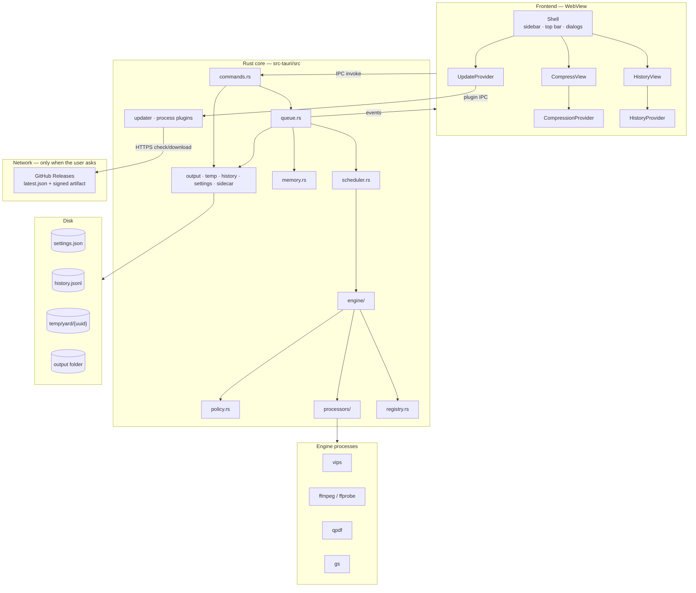
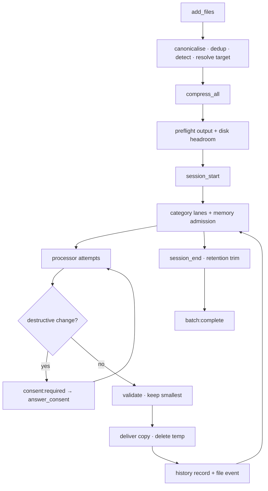

# Yard — Architecture

## 1. What it is

Yard is an offline desktop app that compresses batches of files toward per-category size limits. The user stages files, presses Compress, and bundled command-line engines run over them. Originals are never modified; results are written as copies to a separate output folder. No accounts or telemetry; the only network requests are a user-initiated update check and download (ADR 0015).

- Platforms: macOS (arm64, Intel) and Windows (x64, arm64). Linux builds from source but is not packaged; its chrome is unverified.
- License: GPLv3. Engines keep their own licenses: FFmpeg GPLv2+, Ghostscript AGPLv3, libvips LGPLv3, qpdf Apache-2.0.
- Scope: the code as it exists today. Decisions live in `docs/adr/`; shipped capabilities in `docs/FEATURES.md`; open bugs in `docs/bugs.md`; CI/CD and release in `docs/cicd-process.md`.

## 2. Stack

| Layer | Technology |
|---|---|
| Desktop shell | Tauri 2.12 (Rust) |
| Frontend | React 19.3 + TypeScript 7.0 + Vite 8.3 (Rolldown) |
| UI | shadcn/ui 4.23 on Base UI, Tailwind CSS 4.3, sonner |
| Rust | Tokio, tokio-util, serde, uuid, dirs, sysinfo, `zip` 9 (deflate only) |
| Tauri plugins | opener, dialog, store, os, window-state, single-instance, updater (native-tls), process |
| Engines | vips 8.18.7, ffmpeg/ffprobe 9.0.2, qpdf 12.4.2, gs 10.08.0. Intel macOS is pinned to vips 8.18.6 / gs 10.07.1 (ADR 0001) |

Release profile: `lto`, `codegen-units=1`, `opt-level=3`, `panic=unwind`, `strip`.

## 3. Components

**Boundary rule:** `src/` renders and calls IPC; every compression decision lives in `src-tauri/src/`.

## 4. Batch lifecycle

1. **Preflight.** Create the output folder, write and delete a probe file, then require `1.1 × largest original` free where outputs land and `largest job estimate / 2` free on the temp volume. Failure emits `batch:error` before any history record.
2. **Cancel tokens** register before the status flips from Pending to Compressing, so a cancel cannot miss a job that just started.
3. **Panics are caught** by `catch_unwind` in release builds (`panic = "unwind"`); one file's panic does not kill the batch (ADR 0014). Each job body runs in `spawn_blocking`.
4. **Output names** try `name.ext`, `stem-1.ext` … `stem-999.ext`, then `stem-overflow.ext`, then a uuid fallback. An in-memory reservation registry stops parallel jobs claiming the same name. Extensions come from `registry.rs`: HEIC/HEIF → JPG, MOV → MP4. An under-target copy keeps its original bytes under the mapped extension.
5. **History is append-per-record.** A failed write emits one `history:error` per batch; compression results are unaffected.

## 5. Frontend

`PlatformProvider → CompressionProvider → QuitGuard / UpdateProvider → HistoryProvider → SidebarProvider → Sidebar + SidebarInset + dialogs`

- **Shell.** `main.tsx` applies the stored or OS theme before the first render, detects the platform through `plugin-os`, then mounts `ErrorBoundary → PlatformProvider → App`. `Shell` owns `activeView` (`compress` | `history`) and dialog state. One view is mounted at a time; there is no router.
- **Views.** Compress has two screens: staging (drop zone + file list + summary footer) and run (header + kanban board, one lane per category). History is a detail pane for the batch selected in the sidebar. Settings and About are dialogs. Settings auto-save after a 400 ms debounce and flush on close.
- **Sidebar.** Stock shadcn `Sidebar`: `offcanvas` on desktop, vendored Sheet below 768px. `HistoryList` lives inside it — batch rows and pagination, the only scroller. The History nav row shows or hides the list; only a batch row navigates. No sidebar search field.
- **State.** Providers sit above the view switch, so the staged list, an in-flight run, filters and the selected batch survive navigation. During a batch Rust is authoritative: the frontend applies events and ignores files that left the list (ADR 0004).

| State | Owner |
|---|---|
| `activeView`, settings/About/filter dialog open | `Shell` in `App.tsx` |
| sidebar open (desktop `open`, mobile Sheet `openMobile`) | `SidebarProvider` — session-only |
| history expanded, selected batch, filters/sort/page/search/data | `HistoryProvider` over `useHistory` |
| `files`, list error | `useFileList` — every mutation calls Rust first |
| run screen, batch number, roster, outcome, progress | `CompressionProvider` + `useCompression` |
| update state, About surface open | `UpdateProvider` — survives dialog close |
| platform; theme; settings draft | `PlatformProvider`; `useTheme`; `SettingsDialog` + `useSettings` |

**IPC commands:** `add_files`, `remove_file`, `clear_list`, `get_settings`, `save_settings`, `reset_settings`, `compress_all`, `answer_consent`, `cancel_file`, `cancel_all`, `reveal_in_folder`, `get_history`, `clear_history`, `open_folder`, `memory_stats`, `quit`.

**Events:** `file:progress`, `file:complete`, `file:error`, `file:cancelled`, `batch:complete`, `batch:error`, `history:error`, `consent:required`, `memory:usage`. Payload fields are camelCase; `FileStatus` values are snake_case; categories are lowercase.

`FileStatus` is `pending`, `compressing`, `done`, `best_effort`, `failed`, `cancelled`, `unsupported`, `already_under_target`, `needs_permission`. The TypeScript union in `src/types.ts` is checked against the Rust enum by a file-reading test. `HistoryFilters` carries `sort` (`newest` default, `oldest`); sorting happens before pagination.

**Window and theme.** macOS overlay title bar; Windows frameless; Linux native but unpackaged. `window-state` restores size/position/maximize/visible/fullscreen; `single-instance` focuses the existing window (ADR 0007). Theme follows `localStorage["yard-theme"]`, then OS preference, and syncs the native theme.

**Capabilities and CSP.** Plugin defaults, `os:default`, `updater:default`, `process:default`, `window-state:default`, and the window controls; custom commands need no entry. CSP: `script-src 'self'`, `style-src 'unsafe-inline'` for Tailwind.

## 6. Rust core

Modules: `lib.rs` (wiring, menu, state), `commands.rs` (IPC, settings, file list), `queue.rs` (one worker, lifecycle, cancel maps, consent broker, events), `scheduler.rs` + `memory.rs` (lanes and admission), `engine/` + `processors/` (ladder, runner, progress), `policy.rs`, `registry.rs`, `detection.rs`, `output.rs`, `temp.rs`, `history.rs`, `settings.rs`, `sidecar.rs`.

`QueueState::new` starts exactly one worker task. Batches never overlap; parallelism happens inside a batch (ADR 0003, ADR 0010).

- **Scheduling.** One lane per category, one job per lane, file-list order. Admission requires `used + estimate ≤ budget`; estimates are image 4×, PDF 3×, document `max(4 MiB, 4 × input)`, video input + `400 MiB × (width / 1920)²` (unknown width = 3840), other 0. Budget is `clamp(total RAM / 8, 300 MiB, 2 GiB)` when adaptive, otherwise `memoryCeilingMb` clamped the same way. An estimate above the whole budget runs alone. A finished job frees its estimate immediately.
- **Cancel-all** stops new admissions, skips queued jobs (`file:cancelled` + cancelled history record), and lets in-flight jobs finish their terminal writes. `cancel_file` cancels a live token or marks a pending entry cancelled. The runner calls `kill()` and re-checks cancellation after exit, so a cancel wins over an exit code. SIGKILL reaches only the direct child.
- **Memory reporting.** `memory_stats` returns `totalRamBytes`, `budgetBytes`, `processRssBytes`; `memory:usage` reports budget, used and RSS every 2 s during a batch. RSS is display-only and never feeds admission.
- **Engine resolution.** Windows engines with sibling DLLs live in `<install>/resources/engines/<name>/`; the resolver probes that first, then the dev layout. Flat candidates: `{name}-{triple}[.exe]`, `{name}`, `{name}.exe`. ffmpeg/ffprobe use flat candidates only. macOS ships all engines flat in `Contents/MacOS/`. Only `PATH` is touched, and only on Windows; children use `CREATE_NO_WINDOW`.
- **Runner.** Poll every 30 ms. stdout is discarded except qpdf probes (64 KiB cap); stderr is drained on a thread into a 2 KiB tail rendered as the last 500 characters in a failure. qpdf exit 3 is warnings-only; qpdf exit 2 fails the pass.
- **Output commit.** Copy to `<full file name>.yard-tmp`, check cancel between 64 KiB chunks, then hard-link (or checked-rename) into place. A cancel or copy error removes the temp; a final path is never partially written. Video progress parses `time=` and `out_time_ms=` and maps them into the current attempt's range. Missing macOS `gs-resources` degrades to a hint, not a hard failure; Windows gs uses its compiled-in tree.
- **Cleanup.** Stderr/stdout drains are joined after exit. Video deletes attempt outputs and passlogs, PDF deletes attempt files, image checks the token each iteration, document re-checks at every copy step and never deletes a pre-existing output. Temp cleanup always runs at job end.

## 7. Processors

All processors share one contract: a file already under target becomes a plain byte copy (`already_under_target`); each attempt writes its own temp file; a `BestAttempt` tracker keeps the smallest strictly-smaller result; every output is checked — exit code 0 is not success. The under-target shortcut runs before processor work, so its output keeps the original bytes under the mapped extension: a HEIC stays HEIC inside a `.jpg`, a MOV stays MOV inside a `.mp4`, and image orientation/colour normalization does not run. Before delivery, the ladder checks that the rung declared every change it made and asks `policy.rs` for a verdict (ADR 0011, ADR 0012).

| Category | Ladder | Validation |
|---|---|---|
| Image | Quality binary search (≤ 8 steps, floor → 95) at full size; then 0.9× dimension rungs to `minLongEdge` (default 1280 px). PNG skips the search and uses palette compression. Every attempt is `vips thumbnail` with autorotation, sRGB output and `keep=icc`. | Non-zero size; strict vips exit |
| Video | One ABR two-pass at the highest allowed resolution (1080 cap 1920); then CRF 23 and the floor (default 28) at lower allowed resolutions (or the top rung when only one is allowed). Maps all audio/subtitle tracks and chapters; AAC 128 kbps, `yuv420p`, `+faststart`. Attachments require the `DropStream` grant. Clips < 0.5 s are rejected; < 50 kbps skips ABR. | `ftyp` + size; duration within 1 %; one video stream; audio/subtitle counts not below input |
| PDF | qpdf lossless → qpdf `--optimize-images --jpeg-quality=75` (lossy) → gs grid dpi 100/72/50/36 × jpegq 60/40/25/15, filtered by floors (≤ 16 cells, 8 default). Every gs pass uses `-dPDFSETTINGS=/screen` plus explicit color/gray/mono image resolutions. A failing pass continues the ladder. | `%PDF-` header + non-zero size + qpdf `--show-npages` equality |
| Document | Stream entries from the central directory. Only exact `word/media/`, `ppt/media/`, `xl/media/` entries are recompressed via `vips thumbnail` (≤ 8 steps + confirmation), then stored; others deflate at level 9. Failed media keeps original bytes; oversized fallbacks raw-copy. Rejects duplicate names, > 4 GiB uncompressed, > 200:1 ratio. | `ZipWriter` finishes; fixtures reopen and compare the entry set |

Never use ffmpeg `-fs`: it truncates the file. Size is controlled by bitrate, then resolution, then CRF.

## 8. Consent

Seven change kinds × five categories in `policy.rs`: lossy encode, downscale, drop stream, format change, metadata strip, rasterise, page drop (ADR 0012). Each rung declares the changes it can make; an undeclared change removes the attempt. A `NeedsConsent` verdict emits `consent:required`; `answer_consent` grants once or for the batch. Two denials silence repeat prompts for that change in that batch; the answer timeout is 30 minutes. A denied rung is removed immediately. An earlier authorised over-target attempt is still delivered as best effort, carrying only its own authorised changes. `needs_permission` is returned only when no authorised attempt remains. Best effort requires every delivered change to be authorised.

Grants come from `ConsentSource`: `default` (allowed with no grant, or the built-in HEIC → JPEG permission), `global` (`consent.allowDestructive`), `category` (policy-level, no shipped UI), `batch`, and `once`. History stores only non-default sources; old JSONL lines default to an empty change list and no source.

## 9. Data on disk

| Data | Location | Notes |
|---|---|---|
| Settings | `settings.json` via plugin-store, key `settings` | camelCase; every field defaulted; unreadable file falls back to defaults |
| History | `{app_data_dir}/history.jsonl` | Append-only, three record kinds. File records carry `changes` and `consentSource`; both default for old lines. Retention trim (default 90 days, 1…3650) runs at startup and after each batch via temp + rename. Corrupt lines are skipped and counted. |
| Temp | `{OS temp}/yard/{uuid}/` | Attempt outputs, passlogs, extracted document media. Deleted at job end; entries older than 24 h are removed at startup. |
| Outputs | Settings `outputFolder` (default `~/Documents/Compressed`) | Never deleted automatically; names avoid collisions |

Settings: `outputFolder`; `categoryTargets` (`image`, `video`, `pdf`, `document` → `{ size, unit: "KB" | "MB" }`); `qualityFloors` (`image.minQuality` 30 / `image.minLongEdge` 1280, `video.minCrf` 28 / `video.minResolution` 480p, `pdf.minDpi` 72 / `pdf.minJpegQuality` 15, `document.minMediaQuality` 40); `performance.adaptiveMemory` true / `memoryCeilingMb` 2048; `history.retentionDays` 90; `consent.allowDestructive` false / `heicToJpg` true. Legacy `performance.maxConcurrent` is ignored with one warning.

History queries parse the whole retained file per call (ADR 0005); a session is never split across pages and page size defaults to 50.

## 10. Limits and failure behavior

| Fact | Value |
|---|---|
| Batch budget | adaptive: `clamp(total RAM / 8, 300 MiB, 2 GiB)` · fixed: `memoryCeilingMb` clamped the same way |
| Jobs at once | as many as fit the budget; one per category lane |
| Admission estimate | image 4 × input · PDF 3 × input · document `max(4 MiB, 4 × input)` · video input + `400 MiB × (width / 1920)²`, unknown width = 3840 · other 0 |
| Engines per job | image: ≤ 8 quality probes + one vips run per dimension rung · video: ≤ 7 attempts = ≤ 8 ffmpeg runs + ≤ 8 ffprobe probes · PDF: ≤ 18 compression passes + two page probes per validated pass · document: ≤ 9 vips passes per media entry |
| Memory | bounded per file: documents stream one entry; images hold one image; children get the admission estimate. RSS is displayed, never enforced |
| Temp disk | every attempt is kept until job end; documents also extract each media entry. Preflight requires `largest estimate / 2` free |
| Webview | every progress event re-renders the run view; no throttling |

`CompressionError` = `Cancelled`, `NeedsPermission`, `SidecarNotFound`, `SidecarFailed`, `InputFileError`, `OutputFileError`, `DiskFull`, `Unknown`. Adding a variant breaks the build on purpose. Across IPC, errors become strings inside events. Poisoned mutexes recover with a warning; missing history disables history; unreadable settings use defaults; missing gs resources only annotate gs failures. Exit code 0 still gets its output checked.

## 11. Build and distribution

- **Manifest = intention, lock = truth.** `scripts/binaries.manifest.json` (source, sha256, expected version per triple) → `binaries:fetch` verifies and stages → `binaries:lock.json` records what landed. `prep` shapes layouts; `verify` checks arch and versions; `audit` runs a clean-room gs smoke test.
- **Freeze once, consume everywhere (ADR 0001).** `freeze.yml` stages all four triples and publishes `sidecars-<date>` (8 assets). Every consumer unfreezes its triple and verifies the bundle sha; nothing brews outside the freeze run.
- **Packages.** macOS: five `externalBin` engines flat in `Contents/MacOS/`, 71 framework dylibs, `gs-resources`, ad-hoc signed with one entitlement (ADR 0002). Windows: ffmpeg/ffprobe flat beside the exe; vips/gs/qpdf under `resources/engines/<name>/` with their DLLs.
- **Release guard.** Every release row runs `package-gate.mjs`, which opens the built package and runs each engine once. The gate exists because alpha.1 shipped engines that could not start.
- **Workflows.** `ci.yml` (2-row PR gate), `freeze.yml`, `release.yml` (4 native rows), `release-please.yml`. Runbooks and failure handling: `docs/cicd-process.md`.
- Measured macOS arm64 package: ~214 MiB with engines and dylibs.

## 12. Updates

The app ships `tauri-plugin-updater` and `tauri-plugin-process`. There is no background check and no automatic download: `UpdateProvider` (`src/providers/UpdateProvider.tsx`) contacts GitHub only when the user presses **Check for updates** in About. Dev builds disable the button.

- **Manifest.** `plugins.updater.endpoints` points at `https://github.com/initgrep-apps/yard/releases/latest/download/latest.json`, which only resolves for a published, non-prerelease release. `requireSignedVersion` is `true`, so a newer announced version cannot be paired with an older signed artifact. `bundle.createUpdaterArtifacts` makes the release pipeline build the signed artifact and `.sig`.
- **Signature.** The artifact is signed with the operator's Tauri updater key; only the public key is committed (`plugins.updater.pubkey`). This signature is independent of OS code signing (ADR 0002): macOS stays ad-hoc signed and Windows unsigned. The private key and password are the recovery boundary — losing either stops updates for every existing install, and the key cannot be rotated without a manual reinstall.
- **TLS.** The plugin builds with `native-tls` and the OS trust store instead of vendored OpenSSL, which keeps the `aarch64-pc-windows-msvc` cross-compile check free of an OpenSSL build.
- **State.** `idle → checking → current | available | error`; `available → downloading → ready | installing`; an error retries the failed stage. State lives in the provider, so closing About does not cancel a download. Check times out at 15 s, download at 600 s.
- **Surfaces.** About shows the version row, inline state and update card. A top-right toast mirrors downloading, ready, installing and error states only while About is closed; opening About dismisses it.
- **Download and install are split.** A download may run during a batch. If it finishes while `isCompressing` is true, the state becomes `ready` and install waits; **Restart app** stays disabled until the batch ends. On macOS install is followed by `relaunch()`; on Windows `install()` exits and the installer restarts the app.
- **Network boundary.** The only requests are the manifest fetch and the artifact download the user started. No file data, telemetry, or account information leaves the machine; compression never touches the network.
- **Release visibility.** `latest.json` and its `.sig` assets are uploaded to a draft, so updates appear only after an operator publishes (ADR 0015). Existing 1.1.0 installs have no updater and need one manual install.

**Related docs:** `README.md`, `docs/FEATURES.md`, `docs/adr/`, `docs/cicd-process.md`, `docs/bugs.md`, `GLOSSARY.md`.
