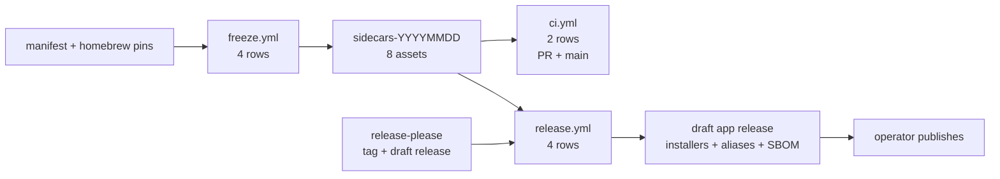

# CI and release process

Yard uses a snapshot-once model: `freeze.yml` builds and pins every engine bundle; all other CI restores those bundles and never installs engines. A runner never chooses an engine version. GitHub-hosted runners only; the local machine is development only.

## 1. Pipeline



| Workflow | Trigger | Scope | Bound |
|---|---|---|---|
| `ci.yml` | PR and push to main | 2 rows: macos-15 arm64, windows-2025 x64 | 60 min |
| `freeze.yml` | dispatch | 4 triples + finalize | 40 min rows, 15 min finalize |
| `release.yml` | `v*` tag or dispatch | 4 native rows | 90 min |
| `release-please.yml` | push to main | draft Release PR | 15 min |

Every gate and release row unfreezes its triple, verifies the bundle sha, runs the clean-room audit, then the verbatim gate: `yarn build && yarn test && cd src-tauri && cargo test`. Mac rows need `BINARIES_ALLOW_INACTIVE_BREW=1` during the audit. Unfreeze writes `src-tauri/.sidecars-restored.json` (`triple`, `bundleSha256`, `restoredAt`); `verify.mjs` treats the marker as governing and skips the `stagedSha256`-vs-lock comparison. `fetch` and `prep` clear stale same-triple markers before staging.

## 2. Freeze and consume

**Manifest = intention, lock = truth.** `scripts/binaries.manifest.json` holds the URL/brew source, sha256 and expected version per triple. `binaries:fetch` verifies and stages; `binaries:lock.json` records what landed. `prep` shapes the platform layout, `verify` checks architecture and versions, `audit` runs a clean-room gs smoke test.

**Freeze rows.**

- Mac: checkout the pinned `homebrew-core` commit per arch, install off the pinned tap with `HOMEBREW_NO_INSTALL_FROM_API=1`, then `all.mjs` → `sync-macos-frameworks` → `freeze.sh --triple`. No `brew update` anywhere.
- Windows: URL + sha256 manifest entries; ffmpeg/ffprobe are static and ship as flat exes; msys2 gs closure is pinned as `extraPackages` (25 x64 + 23 arm64 = 48 rows); no `gs-resources` tree is staged.
- Finalize: create or reuse the same-day draft, upload the 8 assets, verify the exact-8 name set with 4 × 10 s retries through GitHub's asset-indexing lag, then publish. It never publishes an incomplete set.

**Bundle shapes and installed layout.**

| Triple | Bundle | Installed |
|---|---|---|
| macOS arm64 / x64 | 5 flat engines + `frameworks/` + `gs-resources/` | 5 engines flat in `Contents/MacOS/`, 71 framework dylibs, `gs-resources` |
| Windows x64 / arm64 | flat `{name}-{triple}.exe` for every entry + `engines/<dest>/` for non-static engines | ffmpeg/ffprobe flat beside the exe; vips/gs/qpdf under `resources/engines/<name>/` with their DLLs |

Windows gs runs on the ROM model: msys2 ghostscript has no Resource tree and serves PDF, colour-space and image resources from its compiled-in tree. Its DLL closure is staged beside `engines/gs/` and gated by `pe-imports.mjs` + `closure-check.mjs`. `tauri.windows.conf.json` drops the base `gs-resources` mapping with an RFC 7396 null-merge.

## 3. Runbook

**Engine bump → gate → merge → freeze → tag.** There is no local snapshot path.

1. Bump URL engines with `yarn binaries:refresh` (add `--dry-run` to report only). Hand-edit `expectVersion` for brew engines.
2. Update `scripts/ci/homebrew-core-pins.json` only if a manifest `expectVersion` bumped. The Intel pin stays at `c36952de4315` (vips 8.18.6 / gs 10.07.1): homebrew-core stopped publishing x86_64 sonoma bottles on 2026-09-10/11, so nothing newer can be staged from brew. Never bump Intel engines without a human re-verifying that the whole closure has sonoma x86_64 bottles.
3. Run the local gate, commit, merge.
4. Dispatch **Freeze sidecar engines**. Expect 4 green rows and `sidecars-<date>` with 8 assets.
5. Merge the release-please PR, or tag `v<version>`. Then dispatch **Release** with the tag if the tag push did not start it.
6. Verify the draft and publish. Run `docs/distribution-acceptance.md` on the released artifacts.

**Release rules.**

- `package.json` is the tag-version source of truth. The Release gate requires it to equal the tag version. release-please also updates `src-tauri/tauri.conf.json` (`$.version`) and `src-tauri/Cargo.toml` (`$.package.version`) in the Release PR.
- `release.yml` reuses an existing **draft** release for the tag and fails closed if the release is already published. Convert a published release with `gh release edit <tag> --draft` before re-running.
- release-please creates a draft GitHub release and a draft Release PR. Merging the Release PR creates the tag and draft release; merging any other PR does not release.
- Token chain: GitHub App (`RELEASE_PLEASE_APP_ID` + `RELEASE_PLEASE_APP_PRIVATE_KEY`) → `RELEASE_PLEASE_TOKEN` PAT → `GITHUB_TOKEN`. `GITHUB_TOKEN` needs **Allow GitHub Actions to create and approve pull requests**, and events it creates do not trigger `ci.yml` or `release.yml`. With it, reopen the Release PR to get gate rows and dispatch `release.yml` with the tag after merging.
- Squash-merge only. One PR = one changelog entry; write PR titles for humans. Close the Release PR if the build is unwanted.
- Each release row runs `node scripts/ci/package-gate.mjs --triple <triple>` after `tauri-action` populates the draft. The gate opens the built package, asserts every engine where the app resolves it, checks the manifest version, runs one real operation per engine, verifies the gs resource tree, and runs the app's own resolver. A failing row leaves the draft unpublished.
- Each row uploads a stable alias plus checksum: `Yard-macOS-arm64.dmg`, `Yard-macOS-x64.dmg`, `Yard-Windows-x64-setup.exe`, `Yard-Windows-arm64-setup.exe`. README download links use `releases/latest/download/<alias>`.
- The arm64 row uploads `sbom.json` and `THIRD_PARTY_LICENSES.md`; the row verifies both landed.

**Windows-target compile gate.** Run before any push touching `src-tauri/src/`:

```bash
for b in vips qpdf gs ffmpeg ffprobe; do : > src-tauri/binaries/${b}-aarch64-pc-windows-msvc.exe; done && mkdir -p src-tauri/binaries/engines
cd src-tauri && env RC_aarch64-pc-windows-msvc=/opt/homebrew/opt/llvm/bin/llvm-rc CC_aarch64-pc-windows-msvc=/opt/homebrew/opt/llvm/bin/clang cargo check --all-targets --target aarch64-pc-windows-msvc; cd ..
rm -f src-tauri/binaries/*-aarch64-pc-windows-msvc.exe
```

One-time setup: `rustup target add aarch64-pc-windows-msvc` and `brew install llvm`. The placeholders are gitignored and must be removed after the check so `sidecars_are_self_contained` does not see them.

## 4. Failure handling

| Symptom | Meaning | Remedy |
|---|---|---|
| freeze mac row: drift gate fails | pin's formulas no longer match manifest `expectVersion` | refresh the pin or fix the manifest; never hide drift |
| freeze mac row: brew slow or hanging | pin lacks bottles for this closure | arm: re-pin to a commit with `arm64_sequoia` bottles. Intel: restore the newest fully-sonoma-bottled pin; never push forward without bottle re-verification |
| finalize: N/8 after retries | a matrix row failed or artifacts dropped | re-run failed rows/finalize; it reuses the draft and never publishes a partial set |
| same-day `sidecars-<date>` collision | leftover draft | `gh release delete <tag> --cleanup-tag --yes`, then re-run |
| consumer: unfreeze fails or no `sidecars-*` | freeze never ran | run `freeze.yml` first |
| consumer: sha256 mismatch | torn or tampered publish | delete and re-run freeze finalize |
| consumer: audit fails | frozen engines wrong arch/version/stripping | reconcile manifest and re-freeze |
| release: no app assets | build or upload skipped | check tauri-action logs, re-run release |
| package gate: engine missing | package lacks that engine where the app looks | check the platform resource map and the engine `dest` in the manifest |
| package gate: library not loaded (macOS) | bundled dylibs cannot load | check the ad-hoc signature and `Entitlements.plist`; inspect with `codesign -dvvv` |
| package gate: `gs-resources` fails | macOS gs tree missing, partial or hollow | restage with `yarn binaries:prep` and re-freeze |
| package gate: `7z not found` (Windows) | runner image moved 7-Zip | install 7-Zip or pin `SEVEN_ZIP` |

**Platform pitfalls.**

- bash 3.2: guard the ERR trap with a re-entrancy flag; expand possibly-empty arrays as `${arr[@]+"${arr[@]}"}`.
- git-bash: `mktemp -t <name>-XXXXXX` needs trailing X's; GNU tar treats `C:/path` as a remote host, so use the native System32 `tar.exe`.
- brew 7.x: `brew list --versions` output shapes differ; classify `no such keg` and empty output in verification.
- Windows test executables must embed `src-tauri/windows-app-manifest.xml` via `src-tauri/build.rs`; otherwise the loader dies pre-main with `0xc0000139`.

## 5. Open CI work

1. mv-shim cygpath tests are win32-skipped in `freeze.test.mjs` / `unfreeze.test.mjs`. POSIX coverage is complete; verify on a real win32 shell, then un-skip or port.
2. Five lock-refusal tests are win32-skipped because msys bash exits 1 with empty output on the pre-existing-lock path. Observe `acquire_lock` under `bash -x` on Windows, then un-skip.
3. `sbom.mjs` attributes the five top-level engines only. The msys2 closure (freetype, glib2, harfbuzz, …) and mac dylib closure ship their own licenses. Add a component-level license map on the arm64 row.
4. Windows loader diagnostics (`cargo test --no-run`, PE-imports probe, test-enumeration probe) remain in `ci.yml` for the fixed `0xc0000139` class. Decide: keep as canaries or remove.

## 6. Invariants

1. **CI never brews outside `freeze.yml`.** Consumers only unfreeze. Any `brew install`, `brew update` or `all.mjs` in `ci.yml` / `release.yml` is a regression.
2. **Every engine artifact is sha-verified.** Manifest URL pins, freeze digests, unfreeze checks.
3. **Releases are draft-first.** `sidecars-*` and app drafts publish only after verified assets. Finalize counts assets live via `--json assets --jq` and reuses, never replaces, a leftover draft.
4. **Every job carries `timeout-minutes`.** Freeze 40, release rows 90, gate rows 60, cheap jobs 10–15.
5. **No raw `${{ }}` in run strings.** Untrusted context enters via step `env`; actions stay SHA-pinned; `shell: bash` everywhere.
6. **Restore provenance governs verification.** The unfreeze marker pins tree bytes to the verified bundle sha; staging clears stale markers.
