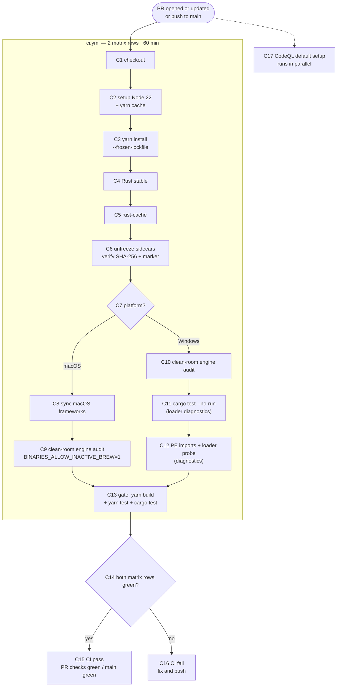
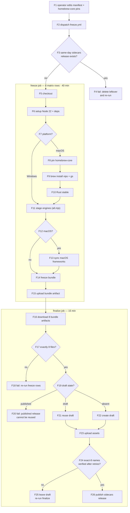

# CI/CD process

Yard uses a snapshot-once model: `freeze.yml` builds and pins every engine bundle; CI verifies pull requests against those bundles; CD freezes engines, versions the app, builds four native installers, and publishes a verified draft. A runner never chooses an engine version. GitHub-hosted runners only; the local machine is development only.

## 1. CI — pull request and main gate



- Required checks on `main`: `gate (aarch64-apple-darwin)` and `gate (x86_64-pc-windows-msvc)`.
- `concurrency` cancels an in-progress run for the same ref. `fail-fast: false` lets both rows finish.
- CodeQL is GitHub default setup, not a workflow file. It reports separately and is not a required branch check.
- Windows loader diagnostics are canaries for the fixed `0xc0000139` class. `cargo test --no-run` still fails on compile errors; the PE-imports and loader-probe steps print evidence only.

## 2. CD — engine freeze



**Freeze rules.**

- Manifest = intention, lock = truth. `scripts/binaries.manifest.json` holds URL/brew source, SHA-256 and expected version per triple; `binaries:fetch` verifies and stages; `binaries.lock.json` records what landed.
- macOS rows checkout the pinned `homebrew-core` commit per arch and install off the pinned tap with `HOMEBREW_NO_INSTALL_FROM_API=1`. No `brew update` anywhere.
- Windows rows use URL + SHA-256 manifest entries. ffmpeg/ffprobe are static and ship as flat exes. The msys2 gs closure is pinned as `extraPackages` (25 x64 + 23 arm64 = 48 rows); no `gs-resources` tree is staged.
- Finalize verifies the exact-8 name set with 4 × 10 s retries through GitHub asset-index lag. It never publishes an incomplete set.
- Unfreeze writes `src-tauri/.sidecars-restored.json` (`triple`, `bundleSha256`, `restoredAt`). `verify.mjs` treats the marker as governing and skips the `stagedSha256`-vs-lock comparison; `fetch`/`prep` clear stale markers.

| Triple | Bundle | Installed |
|---|---|---|
| macOS arm64 / x64 | 5 flat engines + `frameworks/` + `gs-resources/` | 5 engines flat in `Contents/MacOS/`, 71 framework dylibs, `gs-resources` |
| Windows x64 / arm64 | flat `{name}-{triple}.exe` for every entry + `engines/<dest>/` for non-static engines | ffmpeg/ffprobe flat beside the exe; vips/gs/qpdf under `resources/engines/<name>/` with their DLLs |

Windows gs runs on the ROM model: msys2 ghostscript has no Resource tree and serves PDF, colour-space and image resources from its compiled-in tree. Its DLL closure is staged beside `engines/gs/` and gated by `pe-imports.mjs` + `closure-check.mjs`. `tauri.windows.conf.json` drops the base `gs-resources` mapping with an RFC 7396 null-merge.

## 3. CD — app release

```mermaid
flowchart TD
    V1["V1 conventional PRs merge to main"] --> V2["V2 release-please maintains<br/>a draft Release PR"]
    V2 --> V3{"V3 release now?"}
    V3 -- no --> V4["V4 close Release PR"]
    V3 -- yes --> V5["V5 merge Release PR<br/>→ tag + draft GitHub release"]
    V5 --> V6{"V6 tag started<br/>release.yml?"}
    V6 -- App/PAT --> G1
    V6 -- GITHUB_TOKEN --> V7["V7 dispatch release.yml<br/>with tag"]
    V7 --> G1

    subgraph GATE["release gate — 15 min"]
        G1["G1 checkout"] --> G2["G2 setup Node 22"]
        G2 --> G3["G3 version sync +<br/>prerelease resolution"]
        G3 --> G4["G4 updater signing preflight<br/>pubkey · endpoint · secret"]
        G4 --> G5{"G5 sidecars release has<br/>all 8 bundle assets?"}
        G5 -- no --> G6["G6 fail: run freeze.yml"]
        G5 -- yes --> G7{"G7 release state?"}
        G7 -- published --> G8["G8 fail: convert to draft<br/>or delete"]
        G7 -- draft --> G9["G9 reuse draft"]
        G7 -- absent --> G10["G10 create draft"]
        G9 --> G11["G11 export release id,<br/>tag and version"]
        G10 --> G11
    end

    G11 --> R1

    subgraph ROWS["release rows — 4 native triples · 90 min"]
        R1["R1 checkout"] --> R2["R2 version sync check"]
        R2 --> R3["R3 setup Node 22 + yarn cache"]
        R3 --> R4["R4 yarn install --frozen-lockfile"]
        R4 --> R5["R5 Rust stable"]
        R5 --> R6{"R6 Windows arm64?"}
        R6 -- yes --> R7["R7 rustup target add<br/>aarch64-pc-windows-msvc"]
        R6 -- no --> R8
        R7 --> R8["R8 rust-cache"]
        R8 --> R9["R9 unfreeze sidecars<br/>verify SHA-256 + marker"]
        R9 --> R10{"R10 platform?"}
        R10 -- macOS --> R11["R11 sync macOS frameworks"]
        R11 --> R12["R12 clean-room engine audit"]
        R10 -- Windows --> R13["R13 clean-room engine audit"]
        R12 --> R14["R14 gate: build + test<br/>+ cargo test"]
        R13 --> R14
        R14 --> R15["R15 tauri-action build<br/>+ sign + upload .sig<br/>+ generate latest.json"]
        R15 --> R16["R16 stable alias + SHA-256"]
        R16 --> R17{"R17 app asset present?"}
        R17 -- no --> R18["R18 row fail: draft stays"]
        R17 -- yes --> R19{"R19 package gate passes?"}
        R19 -- no --> R18
        R19 -- yes --> R20{"R20 arm64 macOS row?"}
        R20 -- yes --> R21["R21 upload SBOM +<br/>third-party notices"]
        R20 -- no --> R22
        R21 --> R22["R22 row pass"]
    end

    R22 --> R23{"R23 all 4 rows green?"}
    R23 -- no --> R24["R24 draft stays unpublished<br/>fix and re-run"]
    R23 -- yes --> R25["R25 verify-updater job<br/>latest.json · platforms · .sig"]
    R25 -- fail --> R24
    R25 -- pass --> R26["R26 manual acceptance<br/>UI + installers + matrix"]
    R26 --> R27{"R27 acceptance pass?"}
    R27 -- no --> R28["R28 keep draft<br/>file bugs and fix"]
    R27 -- yes --> R29["R29 publish draft release"]
```



**Release rules.**

- `package.json` is the tag-version source of truth. The release gate requires it to equal the tag version. release-please also updates `src-tauri/tauri.conf.json` (`$.version`) and `src-tauri/Cargo.toml` (`$.package.version`) in the Release PR.
- release-please maintains a draft Release PR. Merging it creates the tag and a draft GitHub release; merging any other PR does not release. Close the Release PR if the build is unwanted.
- Token chain: GitHub App (`RELEASE_PLEASE_APP_ID` + `RELEASE_PLEASE_APP_PRIVATE_KEY`) → `RELEASE_PLEASE_TOKEN` PAT → `GITHUB_TOKEN`. Events created with `GITHUB_TOKEN` do not trigger `ci.yml` or `release.yml`; with it, reopen the Release PR for gate rows and dispatch `release.yml` with the tag after merging.
- `release.yml` reuses an existing **draft** release for the tag and fails closed if the release is already published. Convert a published release with `gh release edit <tag> --draft` before re-running.
- The gate runs `node scripts/ci/updater-preflight.mjs --require-secret` before the sidecars-availability preflight, with `TAURI_SIGNING_PRIVATE_KEY` from secrets. It fails closed when `bundle.createUpdaterArtifacts` is not `true`, the public key is empty or still `REPLACE_WITH_UPDATER_PUBLIC_KEY`, the endpoint is not the expected `releases/latest/download/latest.json`, `requireSignedVersion` is not `true`, or the signing secret is absent. It never prints the secret; failing here costs seconds instead of four 90-minute rows.
- Each row runs `node scripts/ci/package-gate.mjs --triple <triple>` after `tauri-action` populates the draft. The gate opens the built package, asserts every engine where the app resolves it, checks the manifest version, runs one real operation per engine, verifies the gs resource tree, and runs the app's own resolver. A failing row leaves the draft unpublished.
- Each row passes `TAURI_SIGNING_PRIVATE_KEY` and `TAURI_SIGNING_PRIVATE_KEY_PASSWORD` to `tauri-action` and sets `retryAttempts: 3` and `updaterJsonPreferNsis: true`. `tauri-action` signs both Windows install types and macOS app tarballs, uploads one `.sig` per updater artifact, and generates `latest.json` in the draft. The pinned action carries the May 2026 parallel-`latest.json` jitter fix; the retries are the second layer.
- The `verify-updater` job runs on `ubuntu-24.04` after all four rows. It downloads `latest.json`, every `.sig`, and the asset inventory from the draft, then runs `scripts/ci/verify-updater-manifest.mjs`: the manifest version must equal the tag, all eight platform keys (`darwin-*`, `windows-*-nsis`, `windows-*-msi`, and the generic Windows keys) must carry a non-empty URL and signature, every URL must name an asset present in the draft, and the six `.sig` assets must exist and match the manifest signatures. It fails without publishing. It declares `contents: write` because a draft release is hidden from read-only tokens.
- Each row uploads a stable alias plus checksum: `Yard-macOS-arm64.dmg`, `Yard-macOS-x64.dmg`, `Yard-Windows-x64-setup.exe`, `Yard-Windows-arm64-setup.exe`. README download links use `releases/latest/download/<alias>`.
- The arm64 macOS row uploads `sbom.json` and `THIRD_PARTY_LICENSES.md`, then verifies both landed.
- `releases/latest` and its `latest.json` resolve only for a published, non-prerelease release. Drafts and prereleases are invisible to that endpoint, so an installed app cannot see an update before the operator publishes the draft.
- Squash-merge only. One PR = one changelog entry; write PR titles for humans.

## 4. Runbook

**Engine bump → gate → merge → freeze → tag.** There is no local snapshot path.

1. Bump URL engines with `yarn binaries:refresh` (add `--dry-run` to report only). Hand-edit `expectVersion` for brew engines.
2. Update `scripts/ci/homebrew-core-pins.json` only if a manifest `expectVersion` bumped. The Intel pin stays at `c36952de4315` (vips 8.18.6 / gs 10.07.1): homebrew-core stopped publishing x86_64 sonoma bottles on 2026-09-10/11, so nothing newer can be staged from brew. Never bump Intel engines without a human re-verifying that the whole closure has sonoma x86_64 bottles.
3. Run the local gate, commit, merge.
4. Dispatch **Freeze sidecar engines**. Expect 4 green rows and `sidecars-<date>` with 8 assets.
5. Merge the release-please PR, or tag `v<version>`. Dispatch **Release** with the tag if the tag push did not start it.
6. Verify the draft and that `verify-updater` is green, run manual acceptance (§5), then publish.

**Windows-target compile gate.** Run before any push touching `src-tauri/src/`:

```bash
for b in vips qpdf gs ffmpeg ffprobe; do : > src-tauri/binaries/${b}-aarch64-pc-windows-msvc.exe; done && mkdir -p src-tauri/binaries/engines
cd src-tauri && env RC_aarch64-pc-windows-msvc=/opt/homebrew/opt/llvm/bin/llvm-rc CC_aarch64-pc-windows-msvc=/opt/homebrew/opt/llvm/bin/clang cargo check --all-targets --target aarch64-pc-windows-msvc; cd ..
rm -f src-tauri/binaries/*-aarch64-pc-windows-msvc.exe
```

One-time setup: `rustup target add aarch64-pc-windows-msvc` and `brew install llvm`. The placeholders are gitignored and must be removed after the check so `sidecars_are_self_contained` does not see them.

## 5. Manual acceptance

The package gate proves engines start and run from the built package. It does not exercise the UI, the mounted DMG, or the MSI. Run this after all four release rows are green (R23), once `verify-updater` passes (R25), and before publishing (R29).

**UI checks.**

- Add files through the picker and drag & drop; remove one; clear the list.
- Change settings, close, reopen: values persist. Reset restores defaults.
- Compress a PNG, MP4, PDF and DOCX to their targets. Watch progress, cancel one file, then cancel a batch.
- Create and reveal the output folder. Confirm no original was modified.
- Open History: session and file records, filters, sort, pagination, detail changes/consent source, clear history.
- Trigger an error with an unsupported or corrupt file and confirm the message is actionable.
- Kanban: horizontal scrollbar/trackpad panning, thin scrollbar, drag ghost (item and lane), lane grip visibility, pinned-card focus, live compressing re-pin.
- Window: drag surface, minimize/maximize/close, theme toggle, single-instance focus, logical window geometry restore.
- History table: trackpad scroll feel, sticky header, reveal actions.

**Update checks.** Use a published test patch — never the draft under acceptance, which installed apps cannot see — and update from the previous installed version.

- Check with no update available: the About row reads "You're on the latest version."
- Check offline or with GitHub blocked: the error is actionable and the app stays usable.
- Update from a previous install on each artifact: macOS arm64 DMG, macOS x64 DMG, Windows x64 NSIS, Windows x64 MSI, Windows arm64 NSIS, Windows arm64 MSI.
- Start a batch during a download: the update reaches Ready and does not restart until the batch ends; **Restart app** stays disabled while compressing.
- Close About during a download: the toast keeps updating; reopening About shows inline progress.
- Tamper with the artifact or its `.sig` on a local test release: the install is rejected and the app stays on the old version.
- After restart: history, settings and the output folder survive; staged files that had not run are cleared, as the card states.
- An existing 1.1.0 install has no updater and needs one manual installer; only the next published release can self-update.

The Windows WebView2 checks need a real Windows machine. macOS trackpad and drag-overlay checks need a human pass; jsdom and WebKit synthesis cannot cover them.

| Platform | Artifact | PNG | MP4 | PDF | DOCX |
|---|---|---|---|---|---|
| macOS arm64 | DMG | | | | |
| macOS x64 | DMG | | | | |
| Windows x64 | NSIS | | | | |
| Windows x64 | MSI | | | | |
| Windows arm64 | NSIS | | | | |

Mark every row explicitly. Use **not run — no hardware** rather than leaving a cell blank or assuming green. Use real inputs: a PNG with metadata, an MP4 with audio, a text-bearing PDF, and a DOCX with an embedded image.

Record failures with the platform, exact artifact version, file type and input, the exact error text, and whether an output file was produced (size and whether it opens). A screenshot is enough if it contains the error text. Add confirmed defects to `docs/bugs.md`; update this checklist for manual-check gaps.

## 6. Failure handling

| Symptom | Meaning | Remedy |
|---|---|---|
| freeze mac row: drift gate fails | pin's formulas no longer match manifest `expectVersion` | refresh the pin or fix the manifest; never hide drift |
| freeze mac row: brew slow or hanging | pin lacks bottles for this closure | arm: re-pin to a commit with `arm64_sequoia` bottles. Intel: restore the newest fully-sonoma-bottled pin; never push forward without bottle re-verification |
| finalize: N/8 after retries | a matrix row failed or artifacts dropped | re-run failed rows/finalize; it reuses the draft and never publishes a partial set |
| same-day `sidecars-<date>` collision | leftover draft | `gh release delete <tag> --cleanup-tag --yes`, then re-run |
| consumer: unfreeze fails or no `sidecars-*` | freeze never ran | run `freeze.yml` first |
| consumer: SHA-256 mismatch | torn or tampered publish | delete and re-run freeze finalize |
| consumer: audit fails | frozen engines wrong arch/version/stripping | reconcile manifest and re-freeze |
| release: no app assets | build or upload skipped | check tauri-action logs, re-run release |
| package gate: engine missing | package lacks that engine where the app looks | check the platform resource map and the engine `dest` in the manifest |
| package gate: library not loaded (macOS) | bundled dylibs cannot load | check the ad-hoc signature and `Entitlements.plist`; inspect with `codesign -dvvv` |
| package gate: `gs-resources` fails | macOS gs tree missing, partial or hollow | restage with `yarn binaries:prep` and re-freeze |
| package gate: `7z not found` (Windows) | runner image moved 7-Zip | install 7-Zip or pin `SEVEN_ZIP` |

**Platform pitfalls.**

- bash 3.2: guard the ERR trap with a re-entrancy flag; expand possibly-empty arrays as `${arr[@]+"${arr[@]}"}`.
- git-bash: `mktemp -t <name>-XXXXXX` needs trailing X's; GNU tar treats `C:/path` as a remote host, so use the native System32 `tar.exe`.
- brew 7.x: `brew list --versions` output shapes differ; classify `no such keg` and empty output in verification.
- Windows test executables must embed `src-tauri/windows-app-manifest.xml` via `src-tauri/build.rs`; otherwise the loader dies pre-main with `0xc0000139`.

## 7. Open CI work

1. mv-shim cygpath tests are win32-skipped in `freeze.test.mjs` / `unfreeze.test.mjs`. POSIX coverage is complete; verify on a real win32 shell, then un-skip or port.
2. Five lock-refusal tests are win32-skipped because msys bash exits 1 with empty output on the pre-existing-lock path. Observe `acquire_lock` under `bash -x` on Windows, then un-skip.
3. `sbom.mjs` attributes the five top-level engines only. The msys2 closure (freetype, glib2, harfbuzz, …) and mac dylib closure ship their own licenses. Add a component-level license map on the arm64 macOS row.
4. Windows loader diagnostics (`cargo test --no-run`, PE-imports probe, test-enumeration probe) remain in `ci.yml` for the fixed `0xc0000139` class. Decide: keep as canaries or remove.

## 8. Invariants

1. **CI never brews outside `freeze.yml`.** Consumers only unfreeze. Any `brew install`, `brew update` or `all.mjs` in `ci.yml` / `release.yml` is a regression.
2. **Every engine artifact is SHA-verified.** Manifest URL pins, freeze digests, unfreeze checks.
3. **Releases are draft-first.** `sidecars-*` and app drafts publish only after verified assets. Finalize counts assets live via `--json assets --jq` and reuses, never replaces, a leftover draft.
4. **Every job carries `timeout-minutes`.** Freeze 40, release rows 90, gate rows 60, cheap jobs 10–15.
5. **No raw `${{ }}` in run strings.** Untrusted context enters via step `env`; actions stay SHA-pinned; `shell: bash` everywhere.
6. **Restore provenance governs verification.** The unfreeze marker pins tree bytes to the verified bundle SHA; staging clears stale markers.
